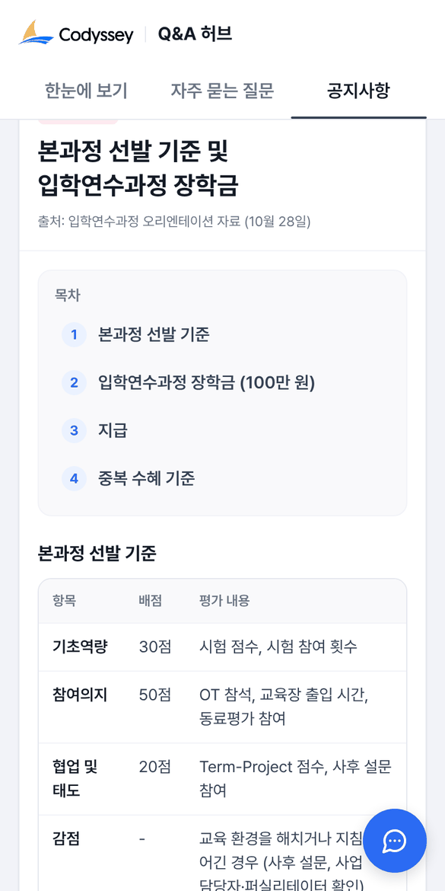
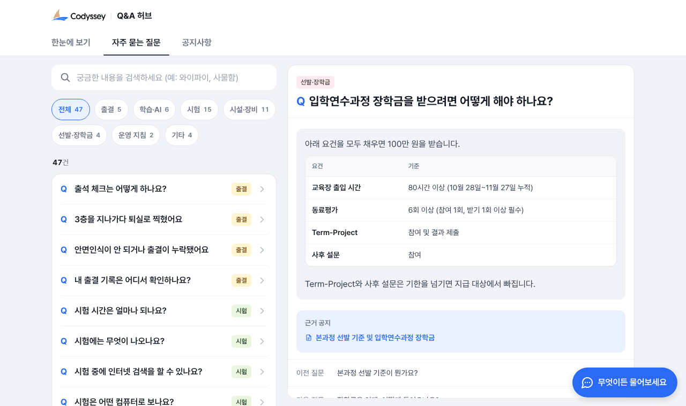

<div align="center">


# 코디세이 Q&A 허브

**디스코드에 묻기 전에, 먼저 찾아보세요.**<br>
대전 코디세이 AI 올인원 1기 공지와 자주 묻는 질문을 한곳에 모은 안내 페이지

**[사이트 바로가기 →](https://sangukjeon.github.io/Codyssey_QnA/)**

`공지 19건` · `자주 묻는 질문 47개` · `분류 7개` · `HTML·CSS·JS만 사용`

</div>

> [!IMPORTANT]
> **코디세이 공식 사이트가 아닙니다.** 교육생이 디스코드 공지와 오리엔테이션·시험 안내 자료를 개인적으로 정리한 비공식 페이지입니다.
> 내용이 원문과 다르면 **디스코드 원문 공지와 운영진 안내를 따라 주세요.** 문제가 되는 내용이 있거나 운영진의 요청이 있으면 바로 수정하거나 사이트를 삭제합니다.

<br>

## 미리 보기

| 홈 · 검색 | 검색 결과 | 공지 목차 · 표 | 챗봇 |
| :---: | :---: | :---: | :---: |
|  |  |  |  |

<details>
<summary><b>PC 화면 (목록 + 상세 2단)</b></summary>
<br>

</details>

<br>

## 주요 기능

| | 기능 | 설명 |
| :---: | --- | --- |
| 🔍 | **한 번에 검색** | 홈 검색창에서 질문과 공지를 함께 찾고, 찾은 단어를 강조합니다. "밥 어디서 먹어"처럼 단어가 정확히 없어도 뜻이 가까운 질문을 찾습니다. |
| 💬 | **안내 챗봇** | 줄임말(비번·엘베·디코)과 구어체를 알아듣고 답과 근거 공지를 보여 줍니다. 확신이 낮으면 "혹시 이 질문인가요?" 하고 후보를 제시합니다. |
| 🗂️ | **분류별 보기** | 출결 · 학습·AI · 시험 · 시설·장비 · 선발·장학금 · 운영 지침 · 기타 |
| 📑 | **읽기 쉬운 공지** | 긴 공지에는 목차가 붙고, 선발 기준·장학금 요건·Wi-Fi·연락처 같은 조건은 표로 정리했습니다. 공지마다 출처를 표시합니다. |
| 🖥️ | **PC 2단 화면** | 화면이 넓으면 왼쪽 목록, 오른쪽 상세로 보여 줍니다. 목록의 검색어와 스크롤은 그대로 남습니다. |
| 📱 | **앱처럼 설치** | 휴대폰에서 "홈 화면에 추가" 또는 "앱 설치"로 바로가기를 만들 수 있습니다. |

<br>

## 담긴 내용

| 출처 | 반영한 내용 |
| --- | --- |
| 디스코드 `allinone-공지사항` | 안면인식 출결, 시설 이용 시간·엘리베이터, Wi-Fi, 사물함, AI 토큰, 시험 안내 등 공지 10건 |
| 입학연수과정 오리엔테이션 자료 (10/28) | 과정 일정, 본과정 선발 기준, 장학금 요건·중복 수혜, 교육장 이용, 퍼실리테이터·네이토, 동료평가 가이드, 운영 지침, 위급 상황 대응 |
| 시험 기능 학습자 가이드 | 접수부터 결과 확인까지, 답안 제출 방식, 재제출 규칙, 시험 네이토 |
| AI 네이티브 과정 교육시설 가이드북 | PC·정보보안 수칙만 반영 (올인원 과정 적용 여부 확인 필요 표시) |

PC 로그인 규칙·초기 비밀번호 규칙처럼 계정과 관련된 정보는 보안상 넣지 않았습니다.

<br>

## 내용 고치기

모든 공지와 질문은 **`js/data.js` 한 파일**에 있습니다. 코드를 몰라도 글만 고치면 됩니다.

<details open>
<summary><b>질문 추가하기</b></summary>

```js
{
  id: 48, cat: "facility", related: [13],          // 분류, 근거 공지 id
  q: "(예시) 질문 제목",
  a: "(예시) 답변 첫 문단\n- 목록 한 줄",          // \n 은 줄바꿈
  keywords: ["핵심어", "줄임말", "구어체 표현"],  // 챗봇이 알아들을 말
  pick: false,                                    // true 면 홈 '먼저 확인할 질문'에 노출
},
```
</details>

<details>
<summary><b>공지 추가하기</b></summary>

```js
{
  id: 20, cat: "etc", pinned: false, files: [],     // pinned: true 면 목록 맨 위 고정
  source: "OT",                                   // 출처 표시 (OT / GB / EXAM, 없으면 디스코드 공지)
  title: "(예시) 공지 제목",
  body: "첫 문단\n\n# 소제목\n- 목록 한 줄\n| 항목 | 내용\n| 가 | 나",
},
```
공지 목록은 배열 순서대로 표시됩니다.
</details>

**본문 작성 규칙**

| 쓰는 법 | 결과 |
| --- | --- |
| `# 소제목` | 굵은 소제목 (공지에 3개 이상이면 목차가 자동으로 생깁니다) |
| `- 내용` | 글머리 목록 |
| `\| 항목 \| 내용` | 표 (연속된 줄이 한 표, 첫 줄은 머리글) |
| 빈 줄 | 문단 간격 |

<br>

## 챗봇 정확도 확인

질문·키워드나 매칭 방식(`js/matcher.js`)을 고친 뒤에는 맞히는 비율을 확인해 주세요.

```bash
node tests/chatbot-eval.js           # 조정용 질문 108개
node tests/chatbot-eval.js holdout   # 조정에 쓰지 않은 확인용 질문 40개
```

| | 기존 키워드 방식 | 지금 |
| --- | :---: | :---: |
| 확인용 질문 40개 | 65% | **75%** (후보 제시 포함 80%) |

여러 질문에 공통으로 나오는 말은 `js/matcher.js`의 같은 뜻 묶음(`SYN`)이나 흔한 말 목록(`GENERIC`)에 넣으면 됩니다.

<br>

## 직접 실행하기

```bash
git clone https://github.com/sangukjeon/Codyssey_QnA.git
cd Codyssey_QnA
python3 -m http.server 8000      # http://localhost:8000
```

빌드 과정은 없습니다. 파일을 고치고 새로고침하면 바로 보입니다.

> [!TIP]
> `css/style.css`나 `js/` 아래 파일을 고쳐서 배포할 때는 `index.html`의 `?v=` 값도 함께 올려 주세요. 그래야 휴대폰 브라우저가 예전 파일을 캐시에서 다시 쓰지 않습니다.

<details>
<summary><b>파일 구성</b></summary>

```
index.html               화면 뼈대, 링크 미리보기 정보
css/style.css            디자인 토큰과 컴포넌트 스타일
js/data.js               공지·질문 데이터 (내용 수정은 여기만)
js/matcher.js            챗봇 질문 매칭
js/app.js                화면 그리기, 검색, 목차·표, PC 2단, 챗봇
tests/                   챗봇 정확도 평가 도구와 질문 모음
assets/                  로고, 아이콘, 링크 미리보기 이미지
docs/images/             README 스크린샷
manifest.webmanifest     앱 설치 정보
sw.js                    앱 설치용 서비스 워커 (요청을 가로채지 않음)
```
</details>

<br>

## 디자인

정부 디자인 시스템(KRDS)의 접근성 기준과 모바일 앱의 차분한 시각 언어를 참고했습니다. 이름·로고·브랜드 색은 가져오지 않았습니다.

- **글꼴:** Pretendard
- **색:** 파란색 `#2B6BF3` 하나와 푸른 기 도는 회색, 분류마다 연한 색
- **형태:** 연회색 바탕 위 흰 카드, 1px 테두리, 넉넉한 둥근 모서리
- **접근성:** 글자 대비 4.5:1 이상, 누르는 영역 44px 이상, 키보드 포커스 표시, 이모지 대신 SVG 아이콘

<br>

---

<div align="center">
<sub>Codyssey 로고와 공지·안내 자료 원문의 권리는 원저작자에게 있습니다. 이 저장소는 교육생이 개인적으로 만든 비공식 정리 페이지입니다.</sub>
</div>
