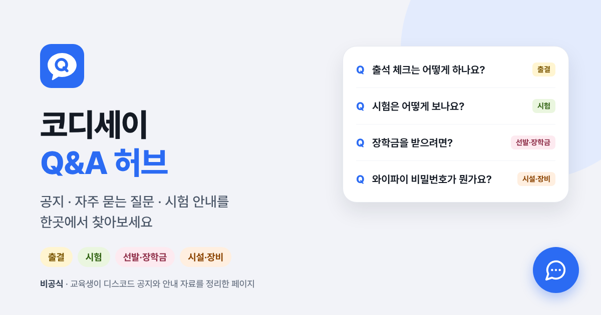
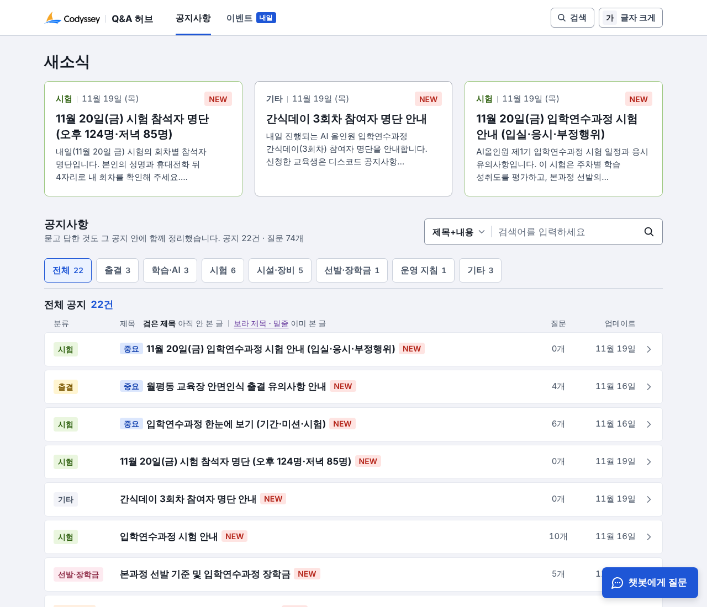
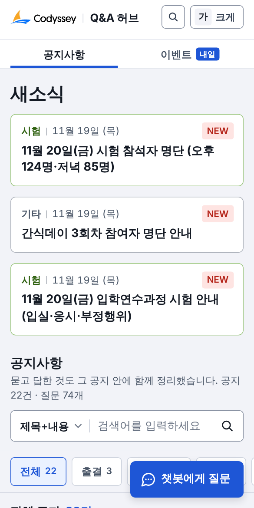
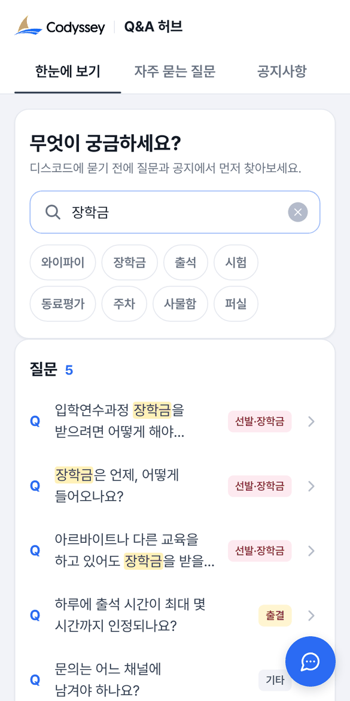
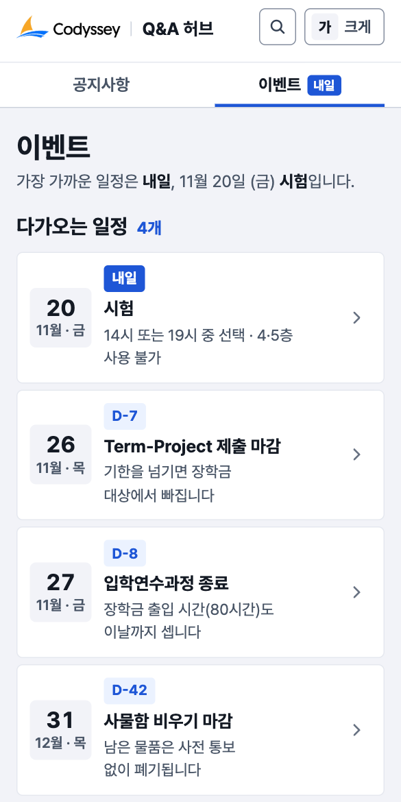
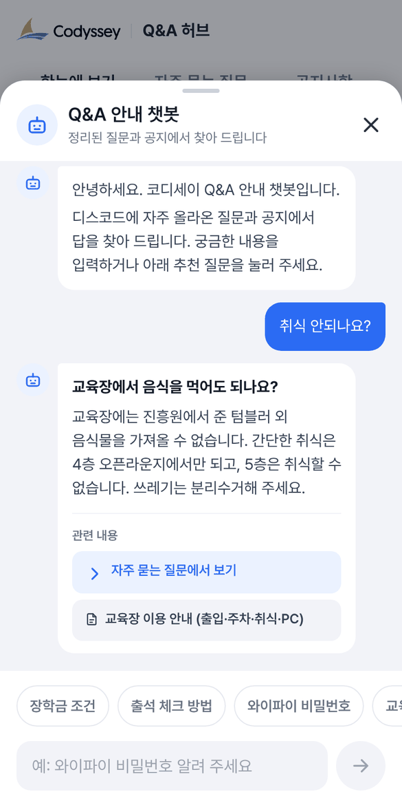

<div align="center">



# 코디세이 Q&A 허브

**디스코드에 묻기 전에, 먼저 찾아보세요.**<br>
대전 코디세이 AI 올인원 1기 공지와 자주 묻는 질문을 한곳에 모은 안내 페이지

**[사이트 바로가기 →](https://sangukjeon.github.io/Codyssey_QnA/)**

`공지 22건` · `공지 안에 묻고 답한 것 74개` · `이벤트 일정` · `HTML·CSS·JS만 사용`

</div>

> [!IMPORTANT]
> **코디세이 공식 사이트가 아닙니다.** 교육생이 디스코드 공지와 오리엔테이션·시험 안내 자료를 개인적으로 정리한 비공식 페이지입니다.
> 내용이 원문과 다르면 **디스코드 원문 공지와 운영진 안내를 따라 주세요.** 문제가 되는 내용이 있거나 운영진의 요청이 있으면 바로 수정하거나 사이트를 삭제합니다.

<br>

## 미리 보기



| 공지사항 · 새소식 | 공지 하나 + 묻고 답한 것 | 검색 결과 | 이벤트 | 챗봇 |
| :---: | :---: | :---: | :---: | :---: |
|  |  |  |  |  |

<br>

## 주요 기능

디스코드에서는 공지도, 문의 답변도 글자만 줄줄이 올라옵니다. 이 사이트는 그것을 **공지사항**과 **이벤트** 두 공간으로 나누고, 흩어진 문의 답변은 **그 공지 안에** 묶어 둡니다.

| 기능 | 설명 |
| --- | --- |
| **두 공간** | 맨 위 메뉴가 공지사항 · 이벤트입니다. 이벤트 옆에는 가장 가까운 일정까지 남은 날(내일 · D-7)이 붙습니다. |
| **새소식** | 가장 최근에 바뀐 공지 3건을 카드로 맨 위에 보여 줍니다(목록 줄과 같은 흰 판에 분류 색 테두리만 두르고, 그림자와 번지는 빛은 쓰지 않습니다). 새 공지뿐 아니라 "새 질문 6개가 붙었습니다"처럼 그 공지에 새로 묶인 질문도 알려 줍니다. 같은 날 여러 건이면 분류가 겹치지 않게 고르고, 7일 동안 NEW가 붙습니다. |
| **공지 목록** | 공지만 제목 한 줄씩 보여 줍니다(분류 · 제목 · 질문 수 · 업데이트한 날). 중요 공지가 맨 위, 그다음은 최근에 바뀐 순입니다. 분류 탭(전체 · 출결 · 학습·AI · 시험 · 시설·장비 · 선발·장학금 · 운영 지침 · 기타)으로 좁힐 수 있고, 스크롤하면 탭이 위에 붙어 따라옵니다. |
| **공지 하나에 다** | 공지를 열면 본문 아래에 **"이 공지에 대해 묻고 답한 것"**이 이어집니다. 질문 줄을 누르면 그 자리에서 답이 펼쳐지고("모두 펼치기"도 있음), 긴 공지에는 목차가, 조건은 표로 정리돼 있습니다. 옆 칸에는 다른 공지에 정리된 관련 질문과 같은 분류의 다른 공지가 붙습니다. |
| **안 본 글 · 본 글** | 제목이 검은색 · 굵게면 아직 안 본 글, 보라색에 밑줄이 있으면 이미 본 글입니다(공지를 열었거나 질문의 답을 본 글). 방문한 링크와 같은 약속이고, 이 브라우저에만 적어 둡니다. |
| **제목+내용 검색** | 검색 범위(제목+내용 · 제목 · 내용)를 고르고 찾습니다. 공지 본문뿐 아니라 그 공지에 묶인 질문과 답까지 찾아서, 공지 줄 아래에 내용 미리 보기와 **맞은 질문**을 함께 보여 줍니다(찾은 낱말 강조). 띄어쓰기·기호가 달라도 찾고("입실퇴실" → "입실·퇴실"), 맨 위에는 "가장 가까운 답"을 바로 펼쳐 보여 줍니다. 글자 그대로 들어 있는 공지가 없으면 "혹시 이 질문인가요?"로 뜻이 가까운 질문을 알려 줍니다. |
| **이벤트** | 시험 · 과제 마감 · 과정 종료처럼 날짜가 정해진 일정을 가까운 순으로, D-day와 함께 보여 줍니다. 지난 일정은 아래로 내려가고, 옆 칸에는 행사 참여 · 신청에 대해 묻고 답한 것이 붙습니다. |
| **안내 챗봇** | 줄임말(비번·엘베·디코)과 구어체를 알아듣고 답과 근거 공지를 보여 줍니다. 확신이 낮으면 "혹시 이 질문인가요?" 하고 후보를 제시합니다. |
| **링크 복사** | 공지(`#notice/12`)와 질문(`#faq/24`)마다 "링크 복사"가 있습니다. 질문 링크를 열면 그 질문이 든 공지가 열리고, 그 질문이 펼쳐진 자리로 내려갑니다. 디스코드에서 같은 질문에 링크로 답할 때 편합니다. |
| **글자 크게** | 맨 위 "글자 크게" 버튼을 누르면 모든 글자가 125%로 커지고, 다음에 와도 그대로 유지됩니다. 브라우저의 글꼴 크기 설정도 따릅니다. |
| **어디서든 검색** | 맨 위 "검색" 버튼은 어느 화면에서든 검색창으로 데려갑니다. 아래로 많이 내려가면 '맨 위로' 버튼이 나타납니다. |
| **발(맨 아래)** | 화면 맨 아래에 코디세이 연락처(위치 · 전화 · 메일 · 공식 사이트)와 이 사이트 안내, 맨 밑줄에 가장 최근 업데이트 날짜를 적어 둡니다. |
| **앱처럼 설치** | 휴대폰에서 "홈 화면에 추가" 또는 "앱 설치"로 바로가기를 만들 수 있습니다. |

<br>

## 담긴 내용

| 출처 | 반영한 내용 |
| --- | --- |
| 디스코드 `allinone-공지사항` | 안면인식 출결, 시설 이용 시간·엘리베이터, Wi-Fi, 사물함, AI 토큰, 시험 안내, 11/20 시험 안내 등 공지 13건 |
| 입학연수과정 오리엔테이션 자료 (10/28) | 과정 일정, 본과정 선발 기준, 장학금 요건·중복 수혜, 교육장 이용, 퍼실리테이터·네이토, 동료평가 가이드, 운영 지침, 위급 상황 대응 |
| 시험 기능 학습자 가이드 | 접수부터 결과 확인까지, 답안 제출 방식, 재제출 규칙, 시험 네이토 |
| AI 네이티브 과정 교육시설 가이드북 | PC·정보보안 수칙만 반영 (올인원 과정 적용 여부 확인 필요 표시) |
| 디스코드 `allinone-문의사항` 운영진 답변 (10/13~11/17, 질문 392건 분석) | 시험 신청·변경·지각·재응시, 동료평가 포인트·취소·피드백·기한, 운영진 추가 시간, LMS 비밀번호, 행사 신청·취소, 프린터·소모임 등 질문 27개 추가와 기존 답 보강. 질문 상세에 답변 날짜를 출처로 표시 |

PC 로그인 규칙·초기 비밀번호 규칙처럼 계정과 관련된 정보는 보안상 넣지 않았습니다. 문의 채널 내용은 교육생 이름을 지우고 운영진 답변만 정리했으며, 행사별 일정과 개인 처리 건은 넣지 않았습니다.

<br>

## 내용 고치기

모든 공지와 질문, 일정은 **`js/data.js` 한 파일**에 있습니다. 코드를 몰라도 글만 고치면 됩니다. 질문은 따로 목록에 나오지 않고, `related`에 적은 **첫 번째 공지 안에** 묶여 나옵니다.

<details open>
<summary><b>질문 추가하기</b></summary>

```js
{
  id: 76, added: "2026-11-20",                    // 고유 번호, 이 사이트에 올린 날 (새소식 · 목록 순서 · NEW 표시에 쓰임)
  cat: "facility", related: [13],                 // 분류, 들어갈 공지 id (첫 번째 공지 본문 아래에 나옴. 꼭 하나는 적기)
  q: "(예시) 질문 제목",
  a: "(예시) 답변 첫 문단\n- 목록 한 줄",          // \n 은 줄바꿈
  keywords: ["핵심어", "줄임말", "구어체 표현"],  // 챗봇이 알아들을 말
  pick: false,                                    // 꼭 알아야 할 질문 표시 (지금 화면에서는 쓰지 않음)
},
```
</details>

<details>
<summary><b>공지 추가하기</b></summary>

```js
{
  id: 20, added: "2026-11-20",                    // 고유 번호, 이 사이트에 올린 날
  cat: "etc", pinned: false, files: [],           // pinned: true 면 '중요' 표시, 목록 맨 위 고정
  date: "2026-11-19",                             // 디스코드 게시일 (선택). 넣으면 added 대신 이 날짜가 쓰임
  source: "OT",                                   // 출처 표시 (OT / GB / EXAM, 없으면 디스코드 공지)
  title: "(예시) 공지 제목",
  body: "첫 문단\n\n# 소제목\n- 목록 한 줄\n| 항목 | 내용\n| 가 | 나",
},
```
목록은 중요 공지가 맨 위, 그다음은 최근에 바뀐 순서입니다. '바뀐 날'은 공지의 날짜(`date`, 없으면 `added`)와 그 공지에 묶인 질문의 `added` 가운데 가장 늦은 날이고, 같은 날끼리는 이 파일에 적힌 순서 그대로입니다. 본문 첫머리는 새소식 카드와 검색 결과의 미리 보기로 쓰입니다.
</details>

<details>
<summary><b>이벤트 일정 · 업데이트 날짜 · 연락처 고치기</b></summary>

```js
const UPDATED = "2026-11-16";   // 화면 맨 아래 '내용 업데이트' 날짜. 내용을 고치면 같이 바꿔 주세요

const SCHEDULE = [               // '이벤트' 화면의 일정. 지난 날짜는 저절로 '지난 일정'으로 내려갑니다
  { date: "2026-11-26", title: "Term-Project 제출 마감", sub: "한 줄 설명", notice: 11 },  // 누르면 공지 11번
  { date: "2026-12-31", title: "사물함 비우기 마감", sub: "한 줄 설명", faq: 16 },        // 누르면 질문 16번
];

const EVENT_FAQS = [72, 73, 74, 63];   // '이벤트' 화면 옆 칸에 보여 줄, 행사 참여 · 신청에 관한 질문 id

const CONTACT = {                // 화면 맨 아래(발)의 코디세이 연락처
  name: "코디세이 대전 · 대전이노베이션아카데미",
  place: "대전 서구 월평동 교육장 (출입은 3층, 교육장은 4·5층)",   // 도로명 주소는 확인되면 덧붙이기
  phone: "042-867-6205", phoneNote: "평일 9:00~18:00, 점심시간 제외",
  night: "042-867-1055", nightNote: "주말·야간",
  email: "qna@codyssey.kr", emailNote: "교육 관련 문의",
  site: "https://codyssey.kr/daejeon",
};
```
행사(미션데이·특강 등)처럼 자주 바뀌는 일정은 넣지 않고, 공지에 나온 정해진 날짜만 넣습니다.
</details>

**본문 작성 규칙**

| 쓰는 법 | 결과 |
| --- | --- |
| `# 소제목` | 굵은 소제목 (공지에 3개 이상이면 목차가 자동으로 생깁니다) |
| `- 내용` | 글머리 목록 |
| `\| 항목 \| 내용` | 표 (연속된 줄이 한 표, 첫 줄은 머리글) |
| 빈 줄 | 문단 간격 |

<br>

## 챗봇 정확도 확인

질문·키워드나 매칭 방식(`js/matcher.js`)을 고친 뒤에는 맞히는 비율을 확인해 주세요.

```bash
node tests/chatbot-eval.js                # 조정용 질문 108개 (직접 만든 문장)
node tests/chatbot-eval.js holdout        # 확인용 질문 40개 (직접 만든 문장)
node tests/chatbot-eval.js real           # 실제 디스코드 문의 문장 109개 (조정에 사용)
node tests/chatbot-eval.js real-holdout   # 실제 문의 문장 30개 (조정에 쓰지 않음 — 진짜 실력)
```

| 질문 모음 | 처음 키워드 방식 | 문의 분석 전 | **지금** |
| --- | :---: | :---: | :---: |
| 실제 문의 확인용 30개 (조정에 안 씀) | — | 27% | **77%** |
| 실제 문의 109개 (조정에 사용) | — | 18% | 99% |
| 확인용 40개 (직접 만든 문장) | 65% | 75% | 85% (후보 포함 90%) |

실제 성능은 **조정에 쓰지 않은 실제 문의 확인용(77%)** 기준으로 보는 것이 정확합니다. 실제 문의 문장은 이름을 지우고 핵심만 남긴 것입니다.

여러 질문에 공통으로 나오는 말은 `js/matcher.js`의 같은 뜻 묶음(`SYN`)이나 흔한 말 목록(`GENERIC`)에 넣으면 됩니다.

<br>

## 방문 통계

[Umami](https://umami.is) 로 익명 방문 통계를 모읍니다. **쿠키를 쓰지 않고 개인을 식별하지 않으며, 챗봇에 입력한 문장은 저장하지 않습니다.** 실제 사이트 주소(`sangukjeon.github.io`)에서만 수집하고, 로컬 실행 중에는 기록되지 않습니다.

| 기록 | 내용 |
| --- | --- |
| 화면 조회 | `/`, `/event`, `/notice/12`, `/faq/24` 처럼 화면마다 (공지와, 공지 안에서 펼친 질문은 제목 함께) → 방문자 수, 이탈률, 머문 시간, 유입 경로, 기기 |
| `search` · `search-scope` | 검색어(30자까지) · 검색 범위와 맞은 공지 · 질문 수, 검색 범위(제목+내용 · 제목 · 내용) 바꾸기 |
| `category` · `qa-all` | 분류 탭(어느 화면에서 눌렀는지 함께), 공지의 '모두 펼치기 · 접기' |
| `news-card` · `head-search` | 새소식 카드 클릭(어느 글인지), 맨 위 '검색' 버튼 |
| `chat-open` · `chat-suggestion` · `chat-ask` · `chat-link` | 챗봇 열기, 추천 질문 클릭, 질문 결과(answer / hint / notice / none)와 연결된 질문 번호, 답변 속 링크 클릭 |
| `copy-link` | 링크 복사 (어떤 질문·공지인지, 성공 여부) |
| `logo-reset` · `app-install` | 로고로 처음 화면 돌아가기, 앱 설치 |
| `text-size` | 글자 크게 / 글자 작게 버튼 (`large` / `normal`) |
| `list-page` · `to-top` | 목록 쪽 번호(몇 쪽으로 갔는지), '맨 위로' 버튼 |

`chat-ask`에서 `result: none`이 많은 시간대·화면을 보면 챗봇이 놓치는 질문 유형을 짐작할 수 있습니다. 통계 코드는 `js/analytics.js`에 있습니다.

<br>

## 직접 실행하기

```bash
git clone https://github.com/sangukjeon/Codyssey_QnA.git
cd Codyssey_QnA
python3 -m http.server 8000      # http://localhost:8000
```

빌드 과정은 없습니다. 파일을 고치고 새로고침하면 바로 보입니다.

> [!TIP]
> `css/style.css`나 `js/` 아래 파일을 고쳐서 배포할 때는 `index.html`의 `?v=` 값도 함께 올려 주세요. 그래야 휴대폰 브라우저가 예전 파일을 캐시에서 다시 쓰지 않습니다.

<details>
<summary><b>파일 구성</b></summary>

```
index.html               화면 뼈대, 링크 미리보기 정보
css/style.css            디자인 토큰과 컴포넌트 스타일
js/data.js               공지·질문·이벤트 일정 데이터 (내용 수정은 여기만)
js/matcher.js            챗봇 질문 매칭
js/analytics.js          방문 통계 (Umami)
js/app.js                화면 그리기(공지사항 · 공지 하나 · 이벤트), 검색, 목차·표, 질문 펼치기, 챗봇
tests/                   챗봇 정확도 평가 도구와 질문 모음
assets/                  로고, 아이콘, 링크 미리보기 이미지
docs/images/             README 스크린샷
manifest.webmanifest     앱 설치 정보
sw.js                    앱 설치용 서비스 워커 (요청을 가로채지 않음)
```
</details>

<br>

## 디자인

정부 디자인 시스템(KRDS)의 접근성 기준과 모바일 앱의 차분한 시각 언어를 참고했습니다. 이름·로고·브랜드 색은 가져오지 않았습니다.

- **글꼴:** Pretendard, 본문 17px · 가장 작은 글자 14px, 크기는 모두 `rem` (글자 크게 = 125%)
- **색:** 파란색 `#1E56D6` 하나와 푸른 기 도는 회색, 분류마다 연한 색. 글 제목은 검은색, 이미 본 글의 제목만 보라색 `#6B3FA0` + 밑줄
- **형태:** 연회색 바탕 위 흰 카드, 1px 테두리, 조금 각진 모서리(태그 4 · 단추와 목록 줄 6 · 카드 8px). 그림자는 떠 있는 것(챗봇 버튼·창, 알림)에만 씁니다. 새소식 카드는 분류 색 테두리로만 구분합니다
- **짜임:** 게임 새소식 게시판처럼 위에 새 글 카드, 아래에 분류 탭 · 검색 · 공지 제목 목록. 질문은 공지 안으로, 일정은 이벤트 화면으로 (휴대폰은 카드와 목록 줄을 세로로 쌓음)
- **접근성:** 글자 대비 4.5:1 이상 (보조 글자는 7:1 가까이), 입력칸 테두리·화살표 3:1 이상, 말줄임 없이 끝까지 표시, 누르는 영역 44px 이상, 키보드 포커스 표시, 이모지 대신 SVG 아이콘

<br>

---

<div align="center">
<sub>Codyssey 로고와 공지·안내 자료 원문의 권리는 원저작자에게 있습니다. 이 저장소는 교육생이 개인적으로 만든 비공식 정리 페이지입니다.</sub>
</div>
